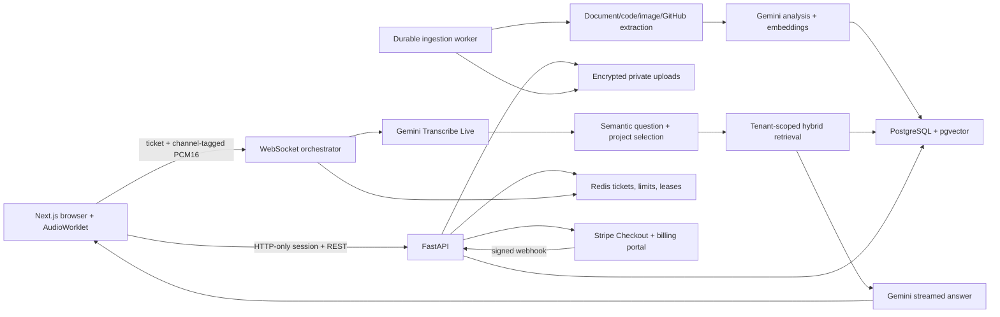

# Architecture

## Boundaries

The browser uses AudioWorklet to resample its native audio rate to mono PCM16 at 16kHz. Frames contain a channel byte: tab/interviewer audio is channel 0 and the candidate microphone is channel 1. Microphone-only input is mixed and is classified semantically, with uncertainty. A bounded queue prevents growing audio backlog. Raw audio is ephemeral and never written to disk.

The backend creates a separate upstream transcription connection for each actual audio channel. Committed transcription drives semantic classification; punctuation is not the detection rule. Previous spoken answers are kept separate from AI suggestions. Contextual follow-ups can retain the active project. A generation ID and cancellation stop older answers from updating the display. Duplicate detection uses question meaning approximation, project, recent candidate speech, and a time window. Gemini session resumption and proactive renewal handle upstream connection limits; browser reconnection obtains a fresh one-use ticket.

Answers use scoped evidence and a bounded profile/conversation excerpt. Exact quotation and locator validation rejects fabricated ingestion citations; labels must be extractive. The assistant may explain technical concepts generally but must not invent personal achievements. This is an evidence policy and tested behavior, not a guarantee that an LLM is infallible.

## Persistence and consistency

SQLAlchemy owns tenant-scoped users, sessions, sources, chunks, projects, turns, usage buckets, and billing event IDs. PostgreSQL HNSW vector search is combined with lexical matches. A visible lexical-only fallback is used if query embedding calls fail; ingestion never marks a source ready without valid embeddings. SQLite search is a bounded development fallback.

Workers claim database-backed source jobs with row locks, durable leases, heartbeat, stale-job recovery, retry bounds, and exponential backoff. Result commits compare the lease token and immutable attribution fields. Repository code is inspected, never executed. Representative file sampling and multimodal extraction limits are surfaced in coverage warnings.

Usage is based on connected server time. A cumulative per-connection ledger makes finalization idempotent even if cancellation happens just after a database commit. One live connection per account is enforced with a renewable lease. Monthly allowances use calendar months in UTC. Provider token charges and application minutes are different quantities.

Retained sessions store transcripts, answers, evidence, and summaries. With retention disabled, conversation text stays only in the current orchestrator's memory; history contains metadata and aggregate timings. A new backend connection cannot restore discarded non-retained context. Source files and the user's knowledge base persist independently until deleted.

## API and future clients

The backend's generated OpenAPI documentation is available in development at `/api/docs`. [The shared contract](CONTRACT.md) documents routes and audio events. Production serves the frontend and API under one HTTPS origin. A future native Android client needs a token-based mobile authentication adapter, native microphone/media projection consent, and the same PCM/event protocol. It does not require a new ingestion or AI service.
